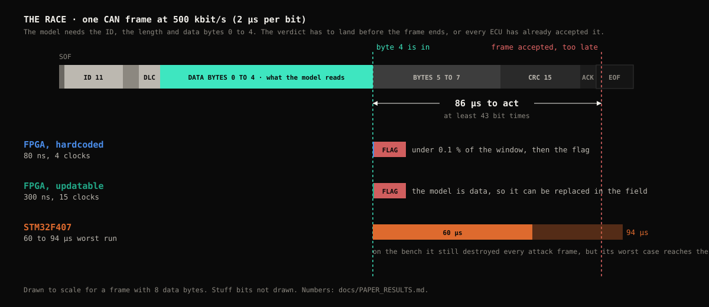
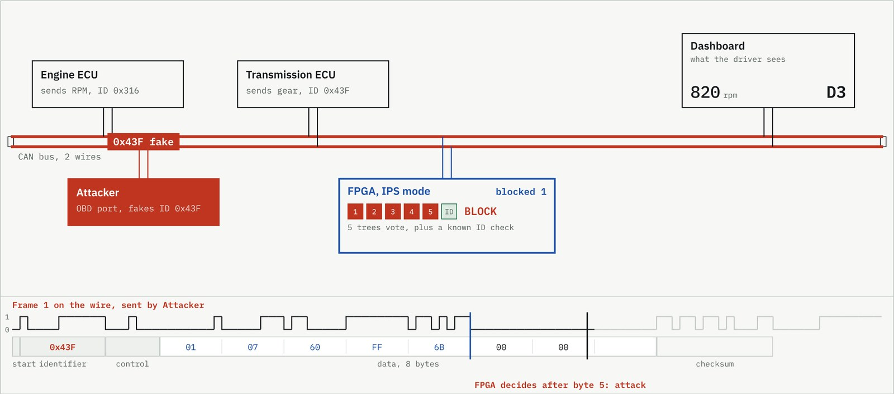
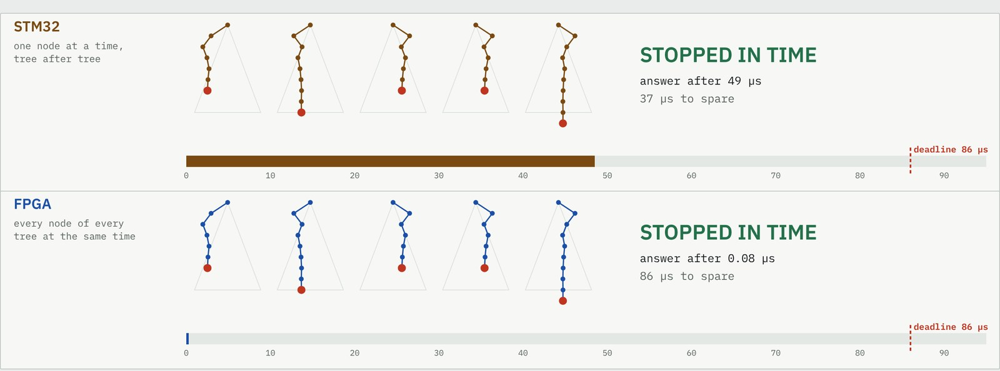
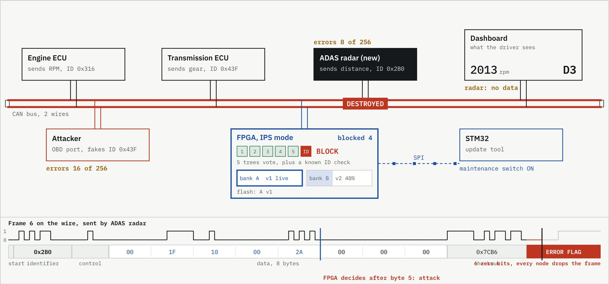
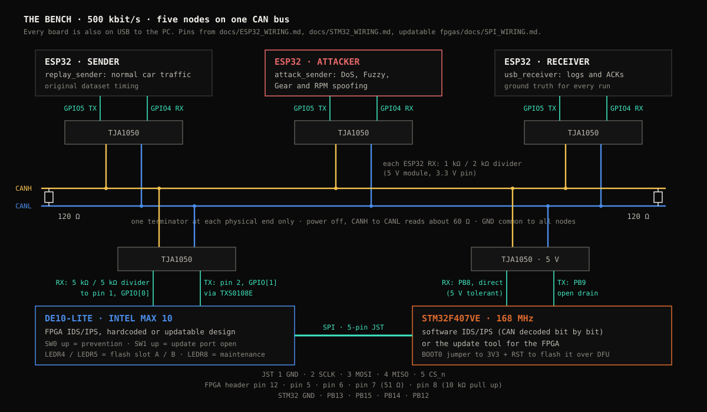
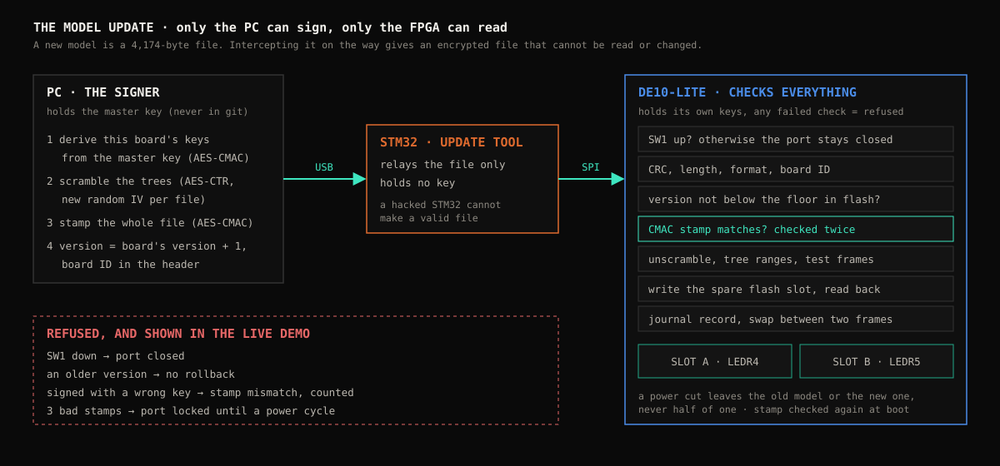

# CAN IDS/IPS: stopping CAN bus attacks on the wire

**One random forest on an FPGA and on a microcontroller, destroying attack frames
before the car's computers accept them, with a secure way to update the model.**
EEN 527 Embedded System Design, ECCE Department, Faculty of Engineering.

<!-- Bench photo goes here: save it as docs/img/bench.jpg and remove these comment marks.

-->

A car's CAN bus has no authentication: any node reached through the OBD port, the
infotainment unit or a modem can flood it, fuzz it or spoof the engine speed. This
project trains one random forest on real attack traffic (Car Hacking Dataset) and
runs that **exact same model** on three detectors, on a real CAN bus:

| Detector | Where the trees live | Decision time | On the bench (all four attacks) |
|---|---|---|---|
| **FPGA, hardcoded** (DE10-Lite, MAX 10) | compiled into logic | 80 ns | every attack frame destroyed, 0 normal frames lost |
| **FPGA, updatable** (same board) | data in RAM, loaded over a signed and encrypted update, kept in flash | 300 ns | every attack frame destroyed, 0 normal frames lost |
| **STM32F407** (168 MHz) | C code, CAN decoded bit by bit in software | worst model run 60–94 µs | every attack frame destroyed, 3 normal frames lost in 1 of 4 attacks |

Accuracy on the 6.5 million frames the model never saw: **99.988 %**, every DoS, Gear
and RPM frame flagged (simulation; Verilog, C and Python agree on every frame).
All numbers with their sources and limits: **[docs/PAPER_RESULTS.md](docs/PAPER_RESULTS.md)**.



## See it

| | |
|---|---|
| **Presentation** | online at [charbel-j-estephan.com/CAN-BUS-PRESENTATION](https://charbel-j-estephan.com/CAN-BUS-PRESENTATION) (29 slides, for landscape screens). The same deck is in [docs/presentation/index.html](docs/presentation/index.html): animated, works offline, drives the live demo, and its results graph takes the runs made on stage. Slides with speaker notes: [CAN_IDS_IPS_presentation.pptx](docs/presentation/CAN_IDS_IPS_presentation.pptx) |
| **Case study** | [charbel-j-estephan.com/projects/can-bus-ids-ips](https://charbel-j-estephan.com/projects/can-bus-ids-ips): the whole project on one page, with results and costs |
| **Interactive walkthrough** | [charbel-j-estephan.com/CAN-IDS-IPS](https://charbel-j-estephan.com/CAN-IDS-IPS): Normal, Attack, IDS, IPS and the model update, animated |
| **STM32 vs FPGA race** | [charbel-j-estephan.com/CAN-COMPARE](https://charbel-j-estephan.com/CAN-COMPARE): the same trees on both chips, who stops the attack in time |

**IPS mode.** The attacker sends a spoofed frame; the FPGA's five trees vote while
the frame is still on the wire, and the error flag destroys it.



**STM32 vs FPGA.** The same trees on both chips, against the 86 µs deadline.



**Signed model update.** A new model arrives over SPI and is written into the
spare flash bank, while the running model keeps protecting the bus.



---

## The live demo

`run_demo.bat` (in this folder) runs the whole demo on the real bench and tells the
presenter, before every step, which switch or jumper to set. Each attack step replays
5,000 real car frames and prints the result in plain words (attack frames that
reached the car, destroyed, normal frames lost, attacker bus off). The update part
prints what to say at each step. The full checklist, wiring and troubleshooting are
in **[docs/DEMO.md](docs/DEMO.md)**.

**Before the talk:** the bench wired (three ESP32s, the DE10-Lite and the STM32 on the
CAN bus, each on its shield), the SPI cable between the two shields. If the DE10-Lite
runs another design (for example Terasic's factory demo), put the project's back first:

```bash
program_fpga.bat
```

then

```bash
run_demo.bat prepare
```

It puts the IDS firmware on the STM32 if needed (it tells you when to take the
shield off and move the BOOT0 jumper, and waits for you).



**On stage:**

```bash
run_demo.bat
```

| Part | Step | Switch | What the audience sees |
|---|---|---|---|
| **1. The FPGA alone** | 1. No protection | SW0 down | a DoS attack: every attack frame reaches the car |
| | 2. The FPGA protects | SW0 up | every DoS frame destroyed, 0 normal frames lost, attacker bus off |
| | 3. Spoofed engine speed (RPM) | SW0 up | every RPM frame destroyed, 0 normal frames lost |
| **2. The STM32 alone** | 4. The STM32 protects | SW0 down | every DoS frame destroyed, in software |
| **3. Updating the FPGA** | the STM32 becomes the update tool | | flashed in seconds (BOOT0 jumper) |
| | 5. Board state | SW1 down | the model, its version, the flash slot it runs from |
| | 6. The update file | | header, the trees before and after scrambling, CRC, stamp |
| | 7. Maintenance off | SW1 down | refused: the update port only opens with the switch on the board |
| | 8. A real update | SW1 up | accepted: new version, LEDR4 / LEDR5 switch slot, the nine checks and steps listed |
| | 9. The previous version again | SW1 up | refused: no rollback |
| | 10. Signed with an attacker's key | SW1 up | refused: stamp mismatch, model unchanged |
| | 11. Close the port | SW1 down | the new model stays, even through a power cut |

The demo signs each new model itself, one version above the board's, with the master
key (`Desktop\master.key`, or set `CAN_MASTER_KEY`), so it can be run again and again.
It shows one forged update per run, far from the three-strike lockout (a power cycle
resets the count). `run_demo.bat attacks` runs parts 1 and 2, `run_demo.bat update`
part 3.

---

## How it works

1. **The model.** `python/train.py` trains 5 trees of depth 9 on the CAN ID, the length
   and data bytes 0–4, with a time split (train on the start of each recording, test
   on the rest). An allow list holds the 38 CAN IDs the car uses: any other ID is
   flagged as Fuzzy without asking the trees. `export_verilog.py` and
   `export_c.py` turn it into Verilog and C.
2. **Prevention.** After data byte 4 there are at least 86 µs before the frame ends.
   On "attack" the detector drives an error flag (six dominant bits): every node drops
   the frame, and the attacker's error counter climbs by 8 per destroyed frame until
   it passes 255 and its controller switches itself off the bus. On the bench that
   took about 22 to 32 destroyed frames, a few milliseconds into the attack.
3. **The updatable FPGA** (`updatable fpgas/`). A fixed tree engine (8 trees × 12
   levels, one RAM per level, one frame per clock) reads the model from memory. A new
   model arrives as a 4,174-byte file over SPI: stamped with AES-CMAC (per-board key),
   scrambled with AES-CTR, refused if older than the board's version, written to the
   flash slot that is not running, and swapped in between two CAN frames. Three bad
   stamps lock the port until a power cycle. The signing master key stays on the PC:
   the STM32 only relays the file and holds no key. Details:
   `updatable fpgas/docs/SECURITY_DESIGN.md`, `BLOB_FORMAT.md`, `RESULTS.md`.
4. **The bench.** Three ESP32s (normal traffic, attacker, logging receiver) replay the
   dataset on a real 500 kbit/s bus with its original timing; the receiver is the
   ground truth for what was destroyed and what was lost.



### Twelve precautions on the update path

| Precaution | What it stops |
|---|---|
| Maintenance switch (SW1, sampled twice) | malware on the PC or a hacked STM32 updating the FPGA on its own |
| One key per board, derived from the master key | a file signed for one board working on another |
| AES-CMAC stamp over the whole file, compared in constant time | anyone without the key making or editing a model |
| Stamp result checked twice, pass = 32-bit code | a single glitched bit accepting a fake |
| AES-CTR scrambling, new IV per file | a copied file or a flash dump revealing the trees |
| Board ID in the header | a valid update for one car replayed on another |
| Version floor in flash | rolling back to an old genuine model |
| Lockout after 3 bad stamps (counter kept twice) | trying key after key |
| CRC, range checks and stored test frames | a damaged or malformed model going live |
| Two flash slots and a journal | a power cut leaving the car without a detector |
| Stamp checked again at every boot | tampering with the stored model in flash |
| Swap between two CAN frames, gated by a swap code | a gap in protection, or a glitch switching to an unchecked bank |

The full list with the details is on slide "Twelve precautions" of the presentation.

## Costs

| Item | Value |
|---|---|
| Hardcoded design | 1,618 LEs (forest alone 1,024 LEs, 2 %), 89 MHz worst case |
| Updatable design | 33,253 LEs (67 %), 146 of 182 M9K blocks (29,869 LEs before the security stage, 40 M9K for the AES S-boxes) |
| Decision latency | 4 clocks (80 ns) hardcoded, 15 clocks (300 ns) updatable |
| STM32 firmware | 42,864 B flash, 29,860 B RAM |
| Update file | 4,174 B |

## Limits

- **Not production ready.** The board's key is inside the FPGA design file. A product
  would program the FPGA encrypted, with JTAG secure and verify protect on, so the key
  cannot be read back. We did not do this on our board.
- **A bench, not a car.** 500 kbit/s, four nodes, short wires. The bench replays the
  first 5,000 or 20,000 frames of each file, so it proves prevention in real time;
  accuracy on unseen frames comes from the 6.5 million frame simulation.
- **A few lost normal frames.** The STM32 lost the same 3 normal RPM frames in every
  20,000-frame run. The updatable FPGA lost 1 normal frame in one DoS rehearsal run
  (0 in every cited run). Not yet explained.
- **Only the 5-byte model on the bench for the updatable FPGA.** 6 and 8 bytes were
  checked in simulation only.

## What's in the repo

| Folder / file | What it is |
|---|---|
| `python/` | training and export (`train.py`, `export_verilog.py`, `export_c.py`), the bench (`run_check.py`, `replay_dataset.py`), the demo (`demo.py`) |
| `hdl/` | the hardcoded FPGA design: CAN receiver, forest (`generated_p5/6/8`), IPS flag, testbenches |
| `quartus_board/` | Quartus project of the hardcoded design for the DE10-Lite |
| `updatable fpgas/` | the updatable FPGA: RTL, signer and push tool, STM32 update tool, testbenches, `run_sim.bat` |
| `mcu/stm32_ids/` | the STM32 IDS/IPS firmware; `mcu/prebuilt/` the two images the demo flashes |
| `esp32/` | the bench sketches: replay sender, attacker, receiver, link test |
| `docs/` | paper results, demo, handover, wiring, build guide, presentation, literature review |
| `run_demo.bat` | the live demo; `program_fpga.bat` puts the design on the DE10-Lite; `run_check_*.bat` the bench tests; `run_sim_FPGA.bat` the hardcoded simulation |

## Reproduce

```bash
git clone --recursive https://github.com/charbel-j-estephan/CAN_IDS_IPS.git
pip install -r requirements.txt
./run_pipeline.sh demo          # tool check on fake data, no download needed
```

With the dataset in `data/car_hacking/`: `python python/train.py --data data/car_hacking
--trees 5 --max-depth 9 --payload-bytes 5`, then the exports. Every simulation of the
updatable FPGA: `updatable fpgas\run_sim.bat` (about 2.5 hours, all steps pass). The
**[build guide](docs/BUILD_GUIDE.md)** has every step from a fresh PC.

## Documents

- [Results for the paper](docs/PAPER_RESULTS.md): every number with its source, and the limits
- [Live demo](docs/DEMO.md): checklist, wiring, troubleshooting
- [Handover](docs/HANDOVER.md): status of every firmware and design version
- [Literature review](docs/literature_review.pdf) and [references](REFERENCES.md)
- Wiring: [ESP32 bench](docs/ESP32_WIRING.md), [STM32](docs/STM32_WIRING.md),
  [STM32 to FPGA SPI](updatable%20fpgas/docs/SPI_WIRING.md)

## Engineering notes

- **FPGA_random_forest could not classify.** Its converter averages the class 0 value
  of each leaf, which acts like a regressor. `export_verilog.py` replaces it with a
  voting classifier.
- **emlearn disagreed with scikit-learn on some frames** (`x <= t` against `x < t`, and
  int16 rounding). `export_c.py` moves every threshold to floor(t) + 0.5.
- **Fast pin edges broke the SPI link on jumper wires** (44 % of reads lost); the STM32
  update tool now uses the slowest pin speed (0 lost in 20,000 reads).

## Team

Anthony El Chakar · Charbel Estephan · Joe Geagea. Instructor: Dr. Abdallah Kassem.

## Acknowledgments

The Car Hacking Dataset comes from the Hacking and Countermeasure Research Lab
(Seo, Song and Kim, PST 2018). The C export uses
[emlearn](https://github.com/emlearn/emlearn) by Jon Nordby. The timing budget
follows Araujo Filho et al., IEEE Access, 2021. The three repos from the original
plan are kept as git submodules for reference.
